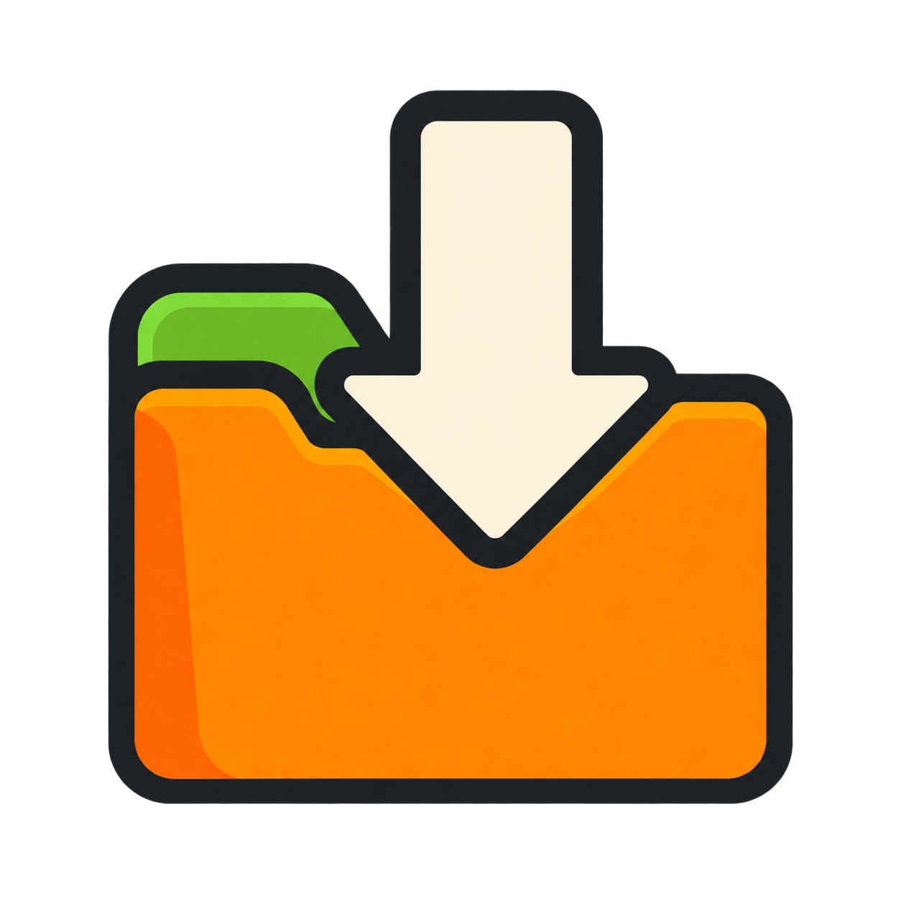
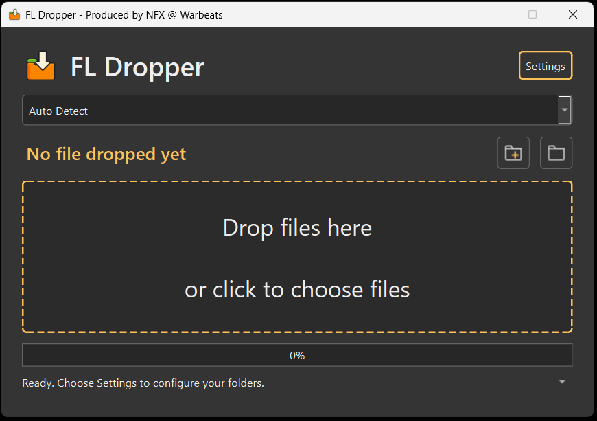

<h1>FL Dropper</h1>

Producer: **Nelson Fernandez Jr. (NFX @ Warbeats)**

Drop FL Studio presets, samples, scripts, projects, folders, or ZIP files into one small window and copy them to the right place. FL Dropper keeps your original files and archives unchanged.

## Install on Windows

1. Download this repository and extract the ZIP, or clone it. Keep the entire folder together in a writable location, such as your Documents folder.
2. Double-click **setup.bat**. Internet access is needed to install dependencies.
3. If Python 3.12 or newer is missing, setup calls **get-python.bat** and asks before attempting a per-user Python 3.12 installation through WinGet. If WinGet is unavailable or installation fails, install Python from [python.org](https://www.python.org/downloads/), enable **Add Python to PATH** if offered, and rerun **setup.bat**.
4. Wait for **Setup complete**, then double-click the **FL Dropper** desktop shortcut or **run.bat**.

You can run **get-python.bat** separately to check Python first. It prompts before installing anything; WinGet may also display license prompts. Existing compatible Python installations are kept.

Setup installs everything the app needs. If setup needs repair, close FL Dropper and run **setup.bat** again. Settings and other app files are preserved.

Setup also creates or refreshes the desktop shortcut. If you move the app folder, rerun **setup.bat** to update it. Keep the icon and other app files together in that folder. If shortcut creation fails, **run.bat** remains available.

## Install on macOS (experimental)

1. Download and extract the repository into a writable folder. Keep the entire folder together, including **FL Dropper.app** and the `scripts` folder.
2. Open Terminal, type `cd `, drag the extracted app folder into Terminal, and press Return.
3. Run:

   ```bash
   bash setup.command
   ```

4. If Python 3.12 or newer is missing, setup calls **get-python.command**. With Homebrew already installed, it asks before installing Python 3.12. Without Homebrew, it offers to open the [official Python download page](https://www.python.org/downloads/macos/). Complete that installer, then rerun `bash setup.command`. The official installer may require an administrator password. Homebrew itself is not installed automatically.
5. Wait for **Setup complete**, then double-click **FL Dropper.app** to launch without Terminal.

Internet access is needed to install dependencies. You can run `bash get-python.command` separately to check Python first. Setup installs the app’s dependencies for you.

Close FL Dropper before rerunning setup to repair or update it. Settings and other app files are preserved.

Keep **FL Dropper.app** in the downloaded app folder. To put a shortcut elsewhere, create a Finder alias rather than moving the app launcher. For troubleshooting, run `bash run.command` in Terminal to see errors, or check `~/Library/Logs/FLDropper.log`.

macOS support is experimental and has not been verified on a Mac. Automatic FL Studio folder discovery and installation-folder validation currently support Windows only. On macOS, configure writable user-data folders or absolute destinations manually in Settings.

## First-time setup

1. Open **Settings** and check the detected FL Studio folders.
2. Use **Auto detect folders** or browse if a folder is missing or incorrect.
3. Choose destinations for content you organize yourself, such as samples and projects.
4. Click **Save**.

The folder settings mean:

| Setting | What to select |
| --- | --- |
| **FL Studio Install Folder** | Your FL Studio program folder. |
| **Shared User Data Folder** | The Image-Line parent folder shown in FL Studio's File settings. |
| **User Data Folder** | Read-only: the `FL Studio` subfolder inside Shared User Data. Updates automatically when you change the shared folder. |

Prefer user-data destinations for your own presets so they carry over when you upgrade FL Studio. You only need to configure the folders used by your destinations.

## Usage of FL Dropper

1. Leave the destination dropdown on **Auto Detect**, or select a destination yourself.
2. Drop files, folders, or ZIP archives onto **Drop files here**. You can also click the panel to select files.
3. Review any destination choices or folder/ZIP import summary, then confirm.



**Auto Detect** chooses destinations for recognized content. Follow any prompts or error messages if an import cannot be identified.

Drop a complete folder or ZIP when presets or scripts need companion files such as samples, helpers, or images. To keep a package together in one place, select a destination before dropping it. Project ZIPs can be kept as ZIP files when offered.

For scores and MIDI files, choose an existing Scores subfolder or create one when prompted.

The highlighted text shows the last dropped filename and plugin. The status line reports the results; click its caret to see individual file details. Use the **folder icon** to open the destination.

### Duplicate filenames

If a destination already contains a file with the same name, choose **Replace**, **Skip**, **Keep both**, or **Cancel remaining**. **Keep both** adds a number to the new filename. You can apply your choice to the remaining conflicts in that import.

In Settings, **Always replace duplicate files (without prompting)** enables automatic replacement for future imports. It is **off by default**.

## Add or change destinations

Click the **folder-plus icon**, choose a folder, and enter the plugin name. The location is saved in the dropdown for future use.

Use **Settings** to rename, edit, disable, or delete destinations and change their accepted file extensions. A destination with no extensions accepts any file when selected manually. Samples and projects can go into folders of your choice. The Scores destination is also editable.

## Update

Close FL Dropper and update or replace the downloaded app files, keeping your `config.json` to preserve settings. On Windows, rerun **setup.bat**, then launch with the desktop shortcut or **run.bat**. On macOS, rerun `bash setup.command`, then open **FL Dropper.app**.

## Your settings

Folders, destinations, and preferences are saved in **config.json in the app folder**. Each copy of FL Dropper has its own settings.

To reset a copy, close the app and rename its `config.json` as a backup. To move your settings to another copy, copy that file. **Settings → Open configuration** opens the configuration file after it has been saved. Keep the app in a writable folder.

Settings from older versions stored under your user profile are not imported automatically. To keep them, copy the old `config.json` into the app folder before launching.

## Troubleshooting

- **Python is missing or too old:** install Python 3.12 or newer, then rerun setup.
- **The app will not start:** run setup again. On Windows, check any messages in the launcher window. On macOS, use `bash run.command` in Terminal to see errors, or check `~/Library/Logs/FLDropper.log`.
- **Auto Detect finds nothing:** browse to your folders in Settings. Automatic discovery is optional.
- **A preset is not recognized:** choose its destination manually. Not every preset format can be identified automatically.
- **Access denied:** check the destination shown in the error. Choose a writable user-data location where appropriate; FL Studio's program folder may be protected.
- **A ZIP cannot be imported:** check that it opens normally and is not encrypted. Unsafe or oversized archives may be rejected.

Implementation details and development checks are in [devnotes.md](devnotes.md).
